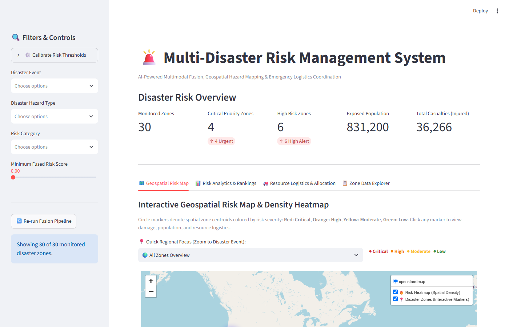
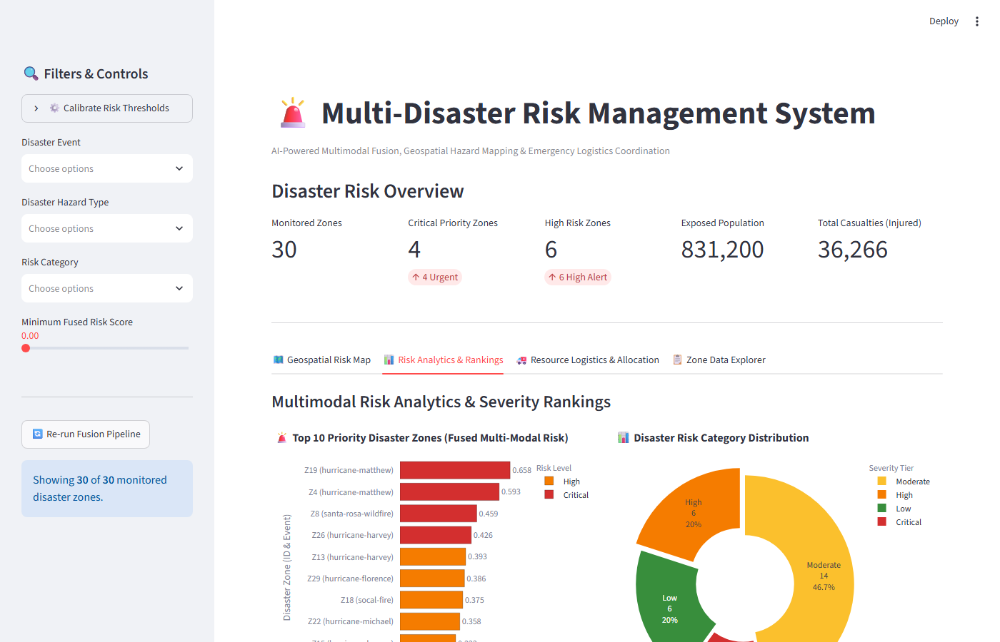
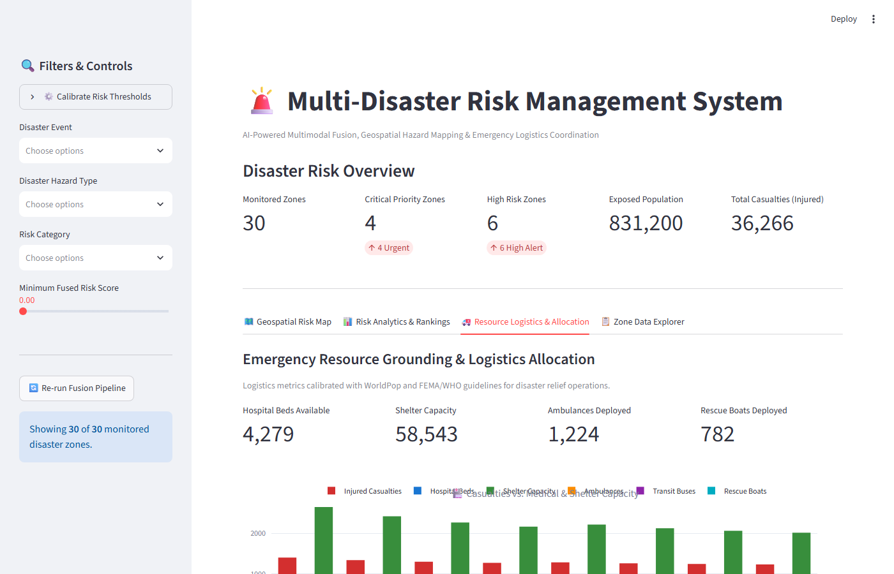
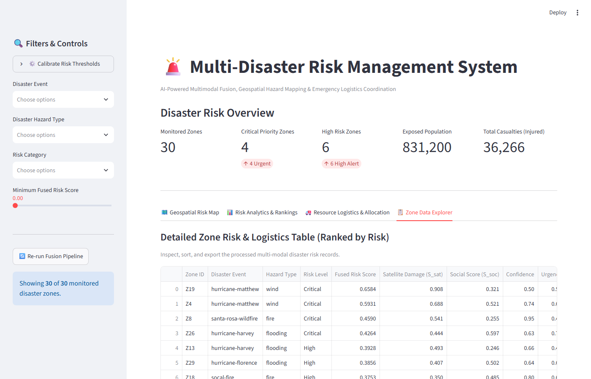

# Multi-Disaster Risk Management System

An integrated multimodal AI platform for multi-disaster perception, geospatial hazard mapping, and emergency logistics response.

---

## 🚀 Features

1. **Multimodal Risk Fusion (`member3_Outputs/fusion/`)**
   - Fuses satellite vision damage assessments ($S_{sat}$) with social text sentiment ($S_{soc}$), source confidence, and urgency scores.
   - Evaluates multi-criteria weight sensitivity with Spearman rank correlation analysis against ground truth.

2. **Interactive Web Dashboard (`member3_Outputs/dashboard/`)**
   - **Geospatial Risk Map & Heatmap**: Interactive Folium map with OpenStreetMap tiles displaying spatial risk heatmaps and color-coded zone markers (Red: Critical, Orange: High, Yellow: Moderate, Green: Low).
   - **Multimodal Risk Analytics**: Real-time Plotly charts including Top Critical Zones rankings, risk category distribution, disaster type breakdown, and satellite vs. social text correlation.
   - **Emergency Logistics Allocation**: Tracks hospital bed capacity, shelter availability, ambulances, and rescue boats against casualty and displacement burdens.
   - **Data Explorer & Export**: Searchable and filterable zone records with instant CSV export.

3. **Logistics RL Environment (`member3_Outputs/reinforcement_learning/`)**
   - Gymnasium environment (`DisasterEnv`) for training reinforcement learning agents (DQN, PPO) to optimize resource dispatch under resource constraints.

---

## 📸 Dashboard Preview

**Geospatial Risk Map & Density Heatmap**


**Risk Analytics & Severity Rankings**


**Resource Logistics & Allocation**


**Zone Data Explorer**


---

## 🛠️ Quickstart

### 1. Run Data Integration & Fusion Pipeline
```bash
python member3_Outputs/fusion/fusion_engine.py
python member3_Outputs/fusion/fusion_validation.py
```

### 2. Launch the Streamlit Dashboard
```bash
streamlit run member3_Outputs/dashboard/app.py
```
Open your browser at `http://localhost:8501`.
